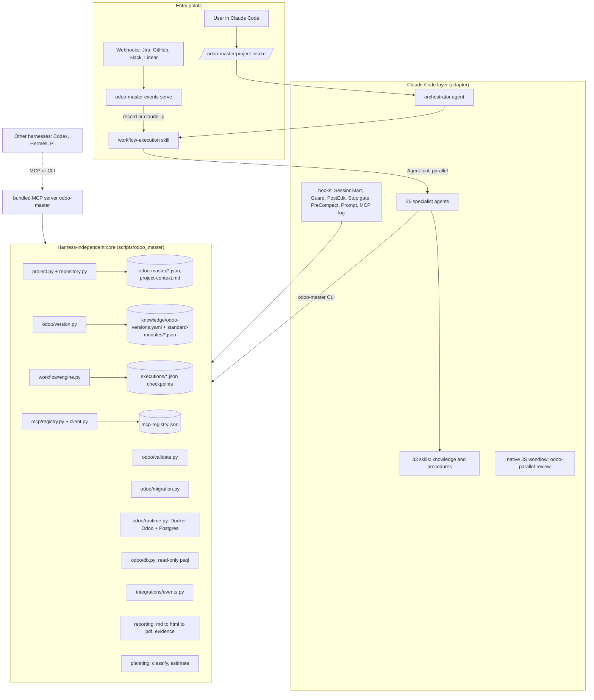
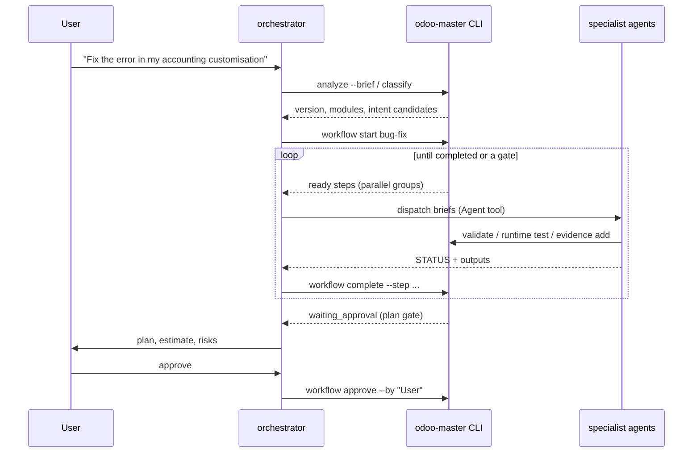
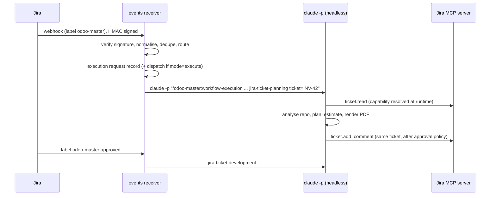

# Architecture

Odoo Master is a Claude Code plugin built on a **harness-independent core**. The core is a Python
package (`scripts/odoo_master`, standard library plus PyYAML and jsonschema) that holds every
deterministic capability: facts, validation, workflow state, the MCP registry, event intake, reports
and evidence. The Claude Code layer (agents, skills, hooks, native workflow, `.mcp.json`) adds judgement
and orchestration on top of that core. It does not reimplement the core.

## Layers and where they live

| Layer (brief) | Implementation | Replaceable by |
|---|---|---|
| Intelligence & orchestration | `agents/orchestrator.md`, `skills/project-intake`, `skills/workflow-execution` | another orchestrator agent or a custom workflow |
| Project understanding | `project.py`, `repository.py`, `odoo/inventory.py` → `.odoo-master/` | — (deterministic) |
| Odoo version intelligence | `odoo/version.py`, `knowledge/odoo-versions.yaml`, `knowledge/standard-modules/` | edit the YAML rules; regenerate the standard maps from new images |
| Requirements, planning, estimation | `requirements-analyst`, `solution-architect`, `planning/classify.py`, `planning/estimate.py`, `config.estimation` | config values, templates |
| Agents & workers | `agents/*.md` (25) | project `.claude/agents/` overrides (higher precedence) |
| Skills & knowledge | `skills/*/SKILL.md` (33), `instructions/`, `docs/research/` | project skills, `instructions.extra_files` |
| Workflow engine | `workflow/engine.py`, `workflows/*.yaml`, `schemas/workflow.schema.json` | project workflows in `.odoo-master/workflows/` (same name overrides) |
| Hooks & automation | `hooks/hooks.json` → `scripts/hook.py` → `odoo_master/hooks/*` | disable the plugin hook or override policies |
| MCP integration | `mcp/registry.py`, `mcp/client.py`, `integrations/*/capabilities.yaml`, bundled `mcp/server.py` | provider profiles in `.odoo-master/integrations/*.yaml` |
| GitHub / Jira / Slack | capability profiles + `github-agent`, `jira-agent`, `integration-engineer` and their skills | any MCP server that provides the capabilities |
| Testing & QA | `odoo/validate.py`, `odoo/runtime.py`, `odoo/logs.py`, `qa-engineer`, `test-automation-engineer` | runtime image/config |
| Visual verification | `scripts/visual/odoo_check.mjs` (Playwright), `visual-qa-engineer` | Playwright MCP |
| Database intelligence | `odoo/db.py` (read-only psql), `odoo-database-engineer`, `database-reviewer` | a Postgres MCP server (capability `db.query`) |
| Migration intelligence | `odoo/migration.py`, rules, `odoo-migration-specialist` | rule table |
| Documentation, reporting & evidence | `reporting/render.py`, `reporting/evidence.py`, `templates/` | templates, PDF engine order |
| Security & guardrails | `policies/*.yaml`, `hooks/guard.py`, `stop_gate.py`, native permissions | managed settings (organisation boundary) |
| Configuration & policy | `config/defaults.yaml` → org file → `.odoo-master/config.yaml` → plugin options → env | every level |
| Platform integration (SaaS/PaaS) | `integrations/events.py` (authenticated intake, dedupe, execution records), `runtime/` adapters | a hosted receiver that implements the same record format |

## Request lifecycle (interactive)

## Event-driven lifecycle (tickets)

MCP is a tool protocol. It is **not** an event bus, so connecting a Jira MCP server never starts a
listener. Events come from webhooks into the receiver, or from a scheduled `claude -p` poll. See
`docs/mcp-integrations.md`.

## Execution state and resumability
- Every workflow execution is a JSON checkpoint plus an append-only event log in `.odoo-master/executions/`.
- `workflow next` is idempotent: it re-lists running steps, applies timeouts, evaluates conditions and approvals.
- The SessionStart hook (also on `compact`) re-injects active executions, and the PreCompact hook tells
  compaction to keep the ids. Together these let a long run survive context compaction (an idea taken
  from Superpowers' bootstrap-on-compact).

## Portability
The core never imports Claude Code code. Two seams expose it:
1. **CLI** (`bin/odoo-master`): usable from any harness that can run shell commands.
2. **MCP server** (`.mcp.json` → `odoo_master.mcp.server`): read-only project intelligence for any MCP-capable runtime.
`odoo_master/runtime/__init__.py` defines the `HarnessAdapter` interface. Only `ClaudeCodeAdapter` is
implemented. Agent and workflow definitions are Markdown/YAML; skills follow the open SKILL.md format.
