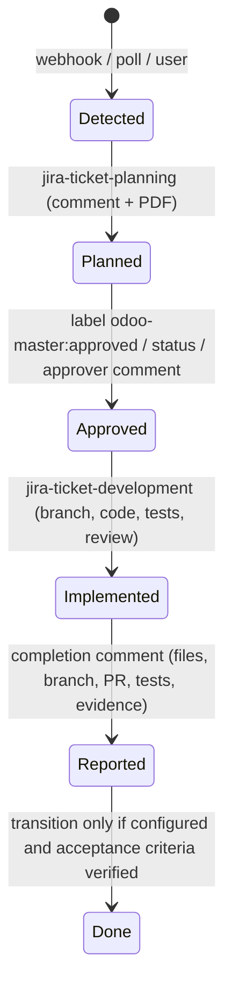

# Jira (and Linear) integration

## Interactive
"Find the Jira ticket assigned to me concerning Odoo inventory errors, analyse it and prepare a plan"
→ `/odoo-master:jira-management`. The agent resolves `ticket.search`, runs a JQL search, asks if more than
one ticket matches, reads the ticket, maps it to a repository, analyses the code, writes the plan and PDF,
and posts the plan comment to **the same ticket**. Posting follows the approval policy.

## Lifecycle


## Automatic triggers (real event mechanisms)
1. Run the receiver where Jira can reach it (behind your HTTPS reverse proxy or tunnel):
   ```
   export ODOO_MASTER_JIRA_WEBHOOK_SECRET=...      # same secret as configured in Jira
   odoo-master events serve --host 127.0.0.1 --port 8787
   ```
2. In Jira, create a webhook or an Automation rule ("When label added → Send web request") to
   `https://<your-host>/events/jira`. Sign it with the secret as `X-Hub-Signature: sha256=<hmac>`; Jira Cloud
   webhooks with a secret send this header. For Automation, add a custom header with the HMAC, or use a proxy that signs.
3. Routes in `integrations/events/routes.yaml` (copy to `.odoo-master/events/routes.yaml`):
   label `odoo-master` → planning, label `odoo-master:approved` → development. You can also route on assignee or status.
4. Dispatch `mode: record` (default) only writes execution requests, with the exact `claude -p` command, to
   `.odoo-master/events/records/`. `mode: execute` launches the command. Execute mode needs a machine where
   Claude Code is authenticated and the Jira MCP server is connected. OAuth MCP servers must be authenticated
   interactively once, because `claude -p` cannot complete OAuth.

**Polling alternative** (no inbound network): a scheduled job runs
`claude -p "/odoo-master:jira-management find tickets with label odoo-master not yet planned and run jira-ticket-planning for each"`.

## Guarantees
- The ticket key is stored on the execution, branch name, comments, reports and evidence.
- Deduplication by delivery id. Unrelated tickets are never updated. Tickets are never closed just because work started.
- Linear works the same way through `ticket.*` capabilities and `/events/linear`.
