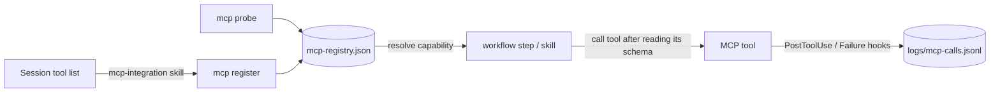

# MCP integrations

## Principles
1. **Any MCP server.** Integrations are described as *capabilities* (`integrations/mcp/capability-taxonomy.yaml`),
   not as hard-coded servers. Provider profiles map real tool names to capabilities. Unknown servers are still
   registered: each tool gets an access class, from annotations or verb heuristics, so it can be selected deliberately.
2. **Discover at runtime.** The session is the source of truth for OAuth-protected servers. Direct probes cover
   stdio and unauthenticated HTTP servers.
3. **Read vs write.** Each tool is classified `read`, `write` or `destructive`. Writes are external actions and
   follow `policies/approvals.yaml`.
4. **No credentials in the plugin.** Tokens stay in the MCP server configuration or Claude Code's OAuth store.
   `odoo-master mcp servers` shows env and header *names* only.

## Commands
```
odoo-master mcp servers                 # configured servers (project .mcp.json, ~/.claude.json, plugin) — redacted
odoo-master mcp probe [--names a,b]     # initialize + tools/list for stdio/HTTP servers; needs_auth for OAuth servers
odoo-master mcp register --tools t.json  # register tools observed in the session (qualified names mcp__server__tool accepted)
odoo-master mcp registry                # .odoo-master/mcp-registry.json
odoo-master mcp resolve ticket.add_comment [--provider jira]
odoo-master mcp log                     # recent MCP calls (metadata only, from the PostToolUse hooks)
```

## Flow


## Shipped provider profiles
| Provider | File | Capabilities (examples) |
|---|---|---|
| Jira / Confluence (Atlassian remote MCP, mcp-atlassian) | `integrations/jira/capabilities.yaml` | ticket.search/read/add_comment/transition/create/update, docs.* |
| GitHub (official MCP server) | `integrations/github/capabilities.yaml` | repo.read_issue/create_branch/create_pull_request/inspect_checks/add_comment, repo.merge (destructive) |
| Slack | `integrations/slack/capabilities.yaml` | chat.search/read_thread/reply_thread/send_message |
| Linear | `integrations/linear/capabilities.yaml` | ticket.* |
| Notion, Confluence, Postgres, Playwright, Google Drive, odoo-master | `integrations/generic/capabilities.yaml` | docs.*, db.*, browser.*, odoo.analyze |
Add your own provider in `.odoo-master/integrations/<name>.yaml`.

## Bundled server
The plugin's `.mcp.json` starts `odoo-master`, a stdio server that exposes read-only project intelligence:
`detect_version`, `project_summary`, `validate_modules`, `migration_scan`, `standard_model_lookup` and
`workflow_status`. Every tool is annotated `readOnlyHint`. It also makes the core usable from other MCP-capable harnesses.

## Failure handling
- Auth error: the PostToolUseFailure hook adds a hint to reconnect (`/mcp`). The workflow step reports `BLOCKED` or continues degraded.
- Disconnection or missing capability: `resolve` returns no tools plus a hint. The agent says what cannot be done and continues with the rest.
- Writes are never retried blindly; the agent first checks whether the first attempt took effect.

## Events are not MCP
MCP has no generic event subscription. Triggers such as "a ticket got label X" arrive through
`odoo-master events serve` (webhooks) or a scheduled poll. See `jira-integration.md`.
