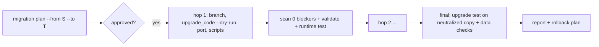

# Migration

See `docs/research/odoo-migration.md` for the background and the `odoo-migration` skill for the procedure.

- `odoo-master migration scan|plan --from 16.0 --to 19.0 [--modules a,b]` lists findings per module with
  file:line, the version the rule applies from, and its source citation, then a hop plan with validation and rollback.
- Rules cover attrs/states (17), init hooks (17), name_get (17), tree→list (18), group_operator (18),
  check_access (18), `_sql_constraints` (19), jsonrpc (19), groups_id→group_ids (19), privileges (19), osv (19),
  private env attributes (19), read_group (19), ir.access (20) and OWL 3 (20).
- Database migration of standard modules is upgrade.odoo.com, Odoo.sh or OpenUpgrade. The plugin ports **custom**
  code and data and verifies the result.
- Production upgrades are `always_human`; the plugin produces the runbook.
