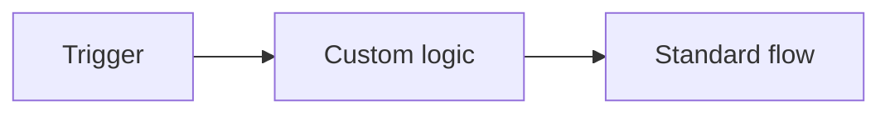

# Technical plan — {{title}}

## 1. Summary
{{one paragraph: what changes and why}}

## 2. Strategy (Odoo reuse ladder)
- Rung chosen: {{standard feature | existing module | data | inheritance | new module}} — {{reason}}
- Alternatives rejected: {{...}}

## 3. Module impact
| Module | Change | New deps | Reverse deps affected |
|---|---|---|---|

## 4. Data model
| Model | Field | Type | Stored | Index | Notes |
|---|---|---|---|---|---|

Constraints (version-correct): {{...}}

## 5. Views & UI
| Base view (id) | Anchor (XPath) | Change |
|---|---|---|

## 6. Security
| Model | Group | CRUD | Rule/domain |
|---|---|---|---|

## 7. Database impact
New tables/columns, renamed/removed stored fields (→ upgrade scripts), backfills, expected volumes.

## 8. Migration considerations
Manifest version bump, `migrations/<version>/` scripts, forward compatibility with the next series.

## 9. Integrations
{{external systems, credentials handling, idempotency}}

## 10. Implementation steps
| # | Step | Files | Verify with |
|---|---|---|---|
| 1 | {{...}} | {{...}} | `odoo-master validate --modules ...` |

## 11. Test plan
| Acceptance criterion | Test | Level |
|---|---|---|

## 12. Risks
| Risk | Likelihood | Impact | Mitigation |
|---|---|---|---|

## 13. Diagram

## 14. Estimate
{{paste `odoo-master estimate --out` markdown}}
