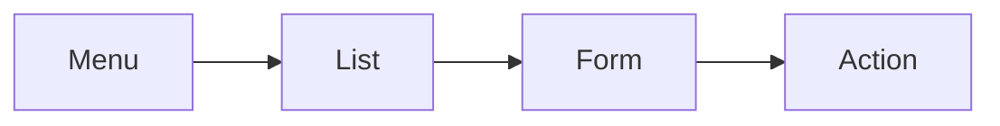

# Wireframe — {{screen}}

Base view: `{{module.view_id}}` · Anchor: `{{xpath}}` · Odoo {{series}}

```
+--------------------------------------------------------------+
| [Button A] [Button B]                     (statusbar: state) |
+--------------------------------------------------------------+
| Field 1 [__________]        | Field 2 [__________ v]         |
| Field 3 [___________________________________________]       |
| Notebook: [Page 1] [Page 2 (new)]                            |
+--------------------------------------------------------------+
```

Flow:

